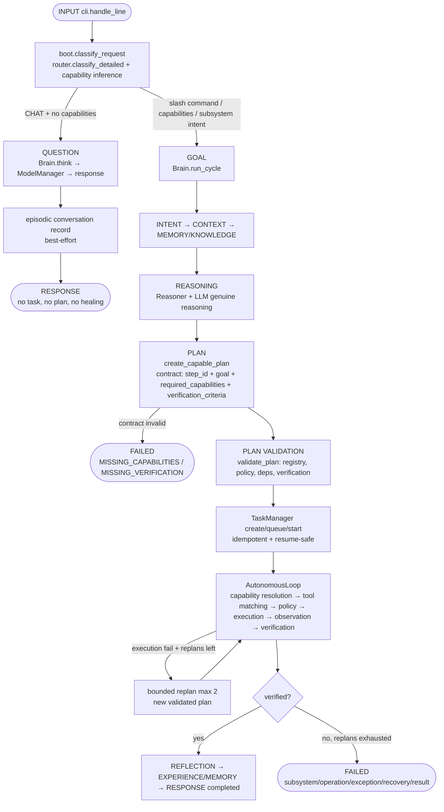

# HERCULE Request Lifecycle Architecture

## Paths

## Consciousness (runtime state, not sentience)

`LISTENING → UNDERSTANDING → THINKING → ACTIVE` (conversation) and
`UNDERSTANDING → PLANNING → EXECUTING → OBSERVING → VERIFYING →
REFLECTING → COMPLETED → ACTIVE` (tasks), with `ERROR → RECOVERING`
on genuine failures and `WAITING` while another attempt owns a task.
Transitions are validated; illegal jumps raise loudly.

## Stage 7: multi-step autonomy

- `decompose_goal()` splits explicit multi-action goals ("then", ";",
  newlines) into ordered steps; `build_capable_plan(..., chain=True)`
  links dependencies. Single-action goals are unchanged.
- Steps carry `step_id/goal/dependencies/required_capabilities/
  required_ability/inputs/expected_output/verification_criteria/risk`.
- The loop gates dependents on verified prerequisites (unmet deps block
  honestly), traces STEP/OBSERVATION/ABILITY/PERMISSION per step, and
  enforces MAX_REPLANS (2), MAX_STEP_RETRIES (1, authoritative over
  replan steps), MAX_TOTAL_EXECUTION_TIME (600s, per-run override).
- Replans classify failures (standard taxonomy), reuse experience
  preferences, and re-enter validation — never invent tools.
- Goals: queued → active → completed/failed/cancelled with priorities,
  dependencies, pause/resume. Tasks persist to `data/tasks.json`
  (`HERCULE_TASK_STORE` override, `:memory:` disables); resume skips
  verified steps, never replays them.
- Post-task self-evaluation (`goal_satisfied/steps_verified/replans/
  recovery/lesson`) is stored with the experience.
`Brain.health()` exposes state, focus, goal counts, recent
transitions — never chain-of-thought.

## Ability & tool layer

- `BaseAbility` is the developer interface: `name/description/capability/
  inputs/outputs/permissions/environments/verification/timeout_s/risk`
  plus `metadata()/validate_input()/environment_satisfied()`. New
  abilities subclass it — Brain is never modified.
- `AbilityManager.execute` validates capability → ability →
  permissions → environment → inputs, enforces HIGH-risk explicit
  approval (`approval_required=True` + `approved=True`), and logs
  `REQUEST → CAPABILITY → SELECTED ABILITY → PERMISSION → EXECUTION →
  VERIFICATION → RESULT`.
- `ToolMatcher.execute_with_fallback` treats structured failure dicts
  (`status` failed/error/pending) as fallback triggers across ranked
  candidates; only `status: success` reaches `verify_step`.
- `verify_math` recomputes calculator output independently; generic
  MATH content falls back to evidence-present.
- Real abilities: `calculator` + `mathematics` (AST arithmetic, MATH),
  `files` (sandboxed read/write/list, FILE_READ/FILE_WRITE),
  `diagnostics` (real OS/Python/CPU/memory, SYSTEM_OBSERVE),
  `terminal` (allowlisted read-only, no shell, 10s timeout,
  HIGH-risk approval, destructive patterns blocked).
- Planner never invents abilities: `validate_plan` + registry health +
  policy gate every step before execution.

## Honesty rules

- `UniversalFallbackMixin.__getattr__` raises honest `AttributeError`
  (subsystem/operation/recovery); it never synthesizes success.
- `OllamaAdapter`/`TransformersAdapter` implement real `generate()`.
- `ModelManager.generate` walks healthy adapters explicitly and
  returns structured `[HERCULE Error]` only after all fail.
- `AutonomousLoop` replans at most `max_replans` (default 2);
  verification (`verify_step`) decides success, never tool output alone.
- Semantic capability resolution is opt-in; deterministic inference
  is always the fallback.

## Benchmarks (this machine)

- `startup_ms≈130`, `think_hi_ms≈0.2`, `task_calculate_ms≈59`
  (`scripts/benchmark_lifecycle.py`).
